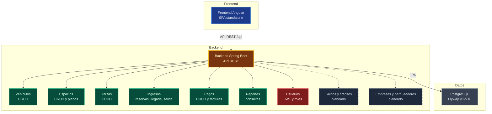

# Diagrama de Arquitectura — ParkFlow360 (ADR)

## Descripción

Diagrama de componentes C4 Level 2 y decisiones de arquitectura. Los módulos
`saldos`, `creditos`, `empresas` y `parqueaderos` son **previstos** (ver
[`especificación`](../01-especificaciones/ESPECIFICACIONES_PARKFLOW360.md)); hoy no existen en el código.

%%{init: {'theme':'dark','themeVariables':{'primaryColor':'#1e293b','primaryTextColor':'#e2e8f0','lineColor':'#94a3b8','tertiaryColor':'#334155','background':'#0f172a'}}}%%

## Decisiones de Arquitectura (ADR)

### ADR-001: Monorepo
**Decisión:** usar monorepo para frontend y backend.  
**Justificación:** simplifica gestión de versiones y despliegue coordinado.  
**Estado:** aceptada.

### ADR-002: Spring Boot + Angular
**Decisión:** backend Java Spring Boot 3.2.5 y frontend Angular 22 standalone.  
**Justificación:** escalabilidad empresarial, tipado fuerte y ecosistema maduro.  
**Estado:** aceptada.

### ADR-003: JWT para autenticación
**Decisión:** Spring Security + JWT stateless, con Google OAuth2 manual.  
**Justificación:** escalable horizontalmente y compatible con SPA.  
**Estado:** aceptada.

### ADR-004: PostgreSQL + Flyway
**Decisión:** PostgreSQL con migraciones versionadas Flyway.  
**Justificación:** consistencia de datos y versionado del esquema.  
**Estado:** aceptada; migraciones actuales V1–V16.

### ADR-005: Despliegue separado
**Decisión:** frontend en Netlify, backend en Render y base de datos en Supabase.  
**Justificación:** optimización de costos y escalabilidad por capa. No se usa Railway.  
**Estado:** aceptada.

### ADR-006: Modelo multiempresa
**Decisión:** empresas con parqueaderos propios (identificador único, capacidad y cupos por tipo de vehículo); filtrado de datos por parqueadero en backend.  
**Justificación:** soportar SaaS con varios clientes y aislamiento de información.  
**Estado:** propuesta (F5–F8).

### ADR-007: Cobro automático con saldo y crédito
**Decisión:** factura única por ingreso, cobro con saldo y, si falta dinero, crédito del faltante con vencimiento a 3 días sin intereses.  
**Justificación:** eliminar filas de pago y mantener trazabilidad con ledger y pagos confirmados.  
**Estado:** propuesta (F1–F3).

### ADR-008: Hora de espera y no-show
**Decisión:** la reserva tiene un límite de una hora; el guardia registra la llegada y un job programado expira las reservas vencidas facturando una hora solo para tarifas `HORA`.  
**Justificación:** desincentivar ausencias sin cobrar tarifas de días u otras modalidades.  
**Estado:** propuesta (F4).

### ADR-009: Roles por responsabilidad
**Decisión:** `PLATAFORMA`, `EMPRESA`, `CAJERO_PAGOS`, `GUARDIA` y `USUARIO`, con cajero y guardia asignados a un único parqueadero.  
**Justificación:** separar pagos, operación en campo y gestión de empresas.  
**Estado:** propuesta (F0, F6–F8).

## Uso

Este diagrama se usa para documentar decisiones técnicas, entender componentes internos, guiar el desarrollo y facilitar el onboarding.
