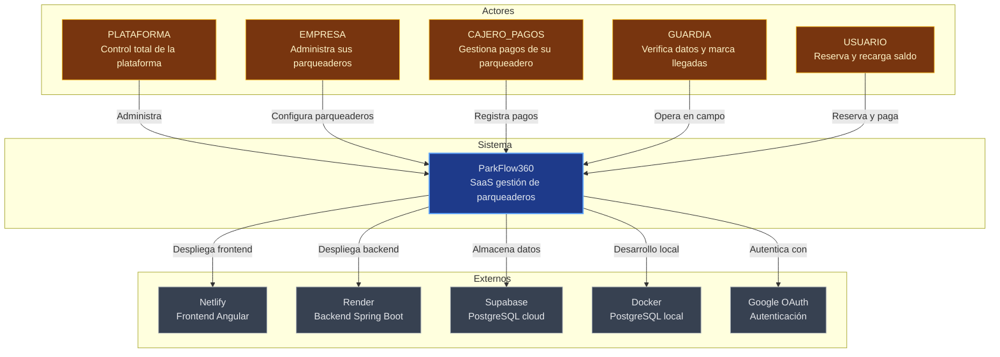

# Diagrama de Contexto — ParkFlow360 (CR)

## Descripción

Diagrama de contexto C4 Level 1. Los actores reflejan el modelo objetivo de la
[`especificación`](../01-especificaciones/ESPECIFICACIONES_PARKFLOW360.md): `PLATAFORMA`, `EMPRESA`, `CAJERO_PAGOS`, `GUARDIA` y `USUARIO`.
Los cinco roles están implementados. `PLATAFORMA` acepta `ADMIN` como alias transitorio para no invalidar tokens vigentes.

%%{init: {'theme':'dark','themeVariables':{'primaryColor':'#1e293b','primaryTextColor':'#e2e8f0','lineColor':'#94a3b8','tertiaryColor':'#334155','background':'#0f172a'}}}%%

## Actores

- **PLATAFORMA**: control absoluto; reemplaza al actual `ADMIN`.
- **EMPRESA**: alta de parqueaderos, configuración de capacidad y cupos, asignación de cajeros y guardias.
- **CAJERO_PAGOS**: usuario exclusivo de un parqueadero, creado con él; revisa, crea y marca pagos.
- **GUARDIA**: verifica datos, marca la llegada y consulta el estado de pago del vehículo.
- **USUARIO**: se vincula a varios parqueaderos por identificador, reserva, recarga y solicita crédito.

## Sistemas externos

- Netlify: frontend estático Angular.
- Render: backend Spring Boot (antes se documentaba también Railway; no está en la configuración del repo).
- Supabase: PostgreSQL de producción.
- Docker: PostgreSQL local de desarrollo.
- Google OAuth: proveedor de identidad del flujo manual existente.

## Uso

Este diagrama se usa para entender los límites del sistema, identificar dependencias externas y documentar actores y flujos de acceso.
