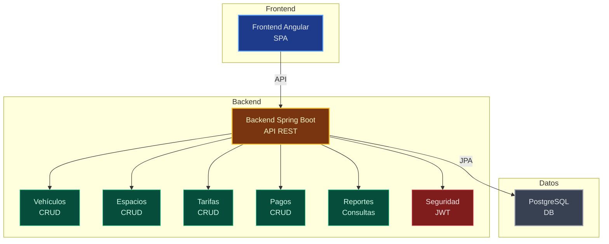

# Diagrama de Arquitectura - ParkFlow360 (ADR)

## Descripción
Diagrama de componentes C4 Level 2 y decisiones de arquitectura.

%%{init: {'theme':'dark','themeVariables':{'primaryColor':'#1e293b','primaryTextColor':'#e2e8f0','lineColor':'#94a3b8','tertiaryColor':'#334155','background':'#0f172a'}}}%%

## Decisiones de Arquitectura (ADR)

### ADR-001: Monorepo
**Decisión:** Usar monorepo para frontend y backend
**Justificación:** Simplifica gestión de versiones y despliegue coordinado
**Estado:** Aceptada

### ADR-002: Spring Boot + Angular
**Decisión:** Backend Java Spring Boot, Frontend Angular
**Justificación:** Escalabilidad empresarial, tipado fuerte, ecosistema maduro
**Estado:** Aceptada

### ADR-003: JWT para autenticación
**Decisión:** Spring Security + JWT stateless
**Justificación:** Escalable horizontalmente, compatible con SPA
**Estado:** Aceptada

### ADR-004: PostgreSQL + Flyway
**Decisión:** PostgreSQL con migraciones Flyway
**Justificación:** Consistencia de datos, versionado de esquema
**Estado:** Aceptada

### ADR-005: Despliegue separado
**Decisión:** Frontend en Netlify, Backend en Railway/Render, DB en Supabase
**Justificación:** Optimización de costos y escalabilidad por capa
**Estado:** Aceptada

## Uso
Este diagrama se usa para:
- Documentar decisiones arquitectónicas
- Entender componentes internos
- Guiar desarrollo y mantenimiento
- Onboarding de nuevos desarrolladores
