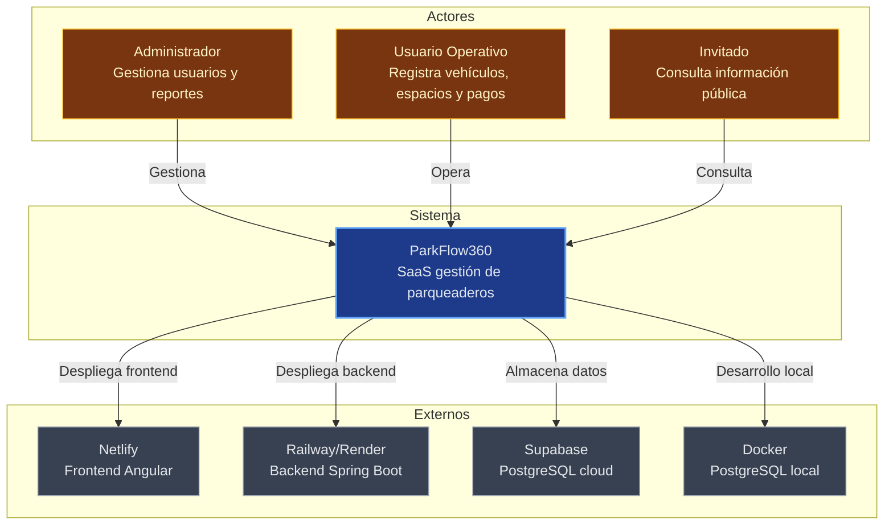

# Diagrama de Contexto - ParkFlow360 (CR)

## Descripción
Diagrama de contexto C4 Level 1 que muestra el sistema ParkFlow360 y sus actores externos.

%%{init: {'theme':'dark','themeVariables':{'primaryColor':'#1e293b','primaryTextColor':'#e2e8f0','lineColor':'#94a3b8','tertiaryColor':'#334155','background':'#0f172a'}}}%%

## Actores
- **Administrador**: Acceso completo, gestión de usuarios y configuración
- **Usuario Operativo**: CRUD de módulos operativos
- **Invitado**: Acceso limitado a información pública

## Sistemas Externos
- Netlify: Frontend estático Angular
- Railway/Render: Backend Spring Boot
- Supabase: Base de datos PostgreSQL
- Docker: Entorno local de desarrollo

## Uso
Este diagrama se usa para:
- Entender límites del sistema
- Identificar dependencias externas
- Documentar actores y flujos de acceso
